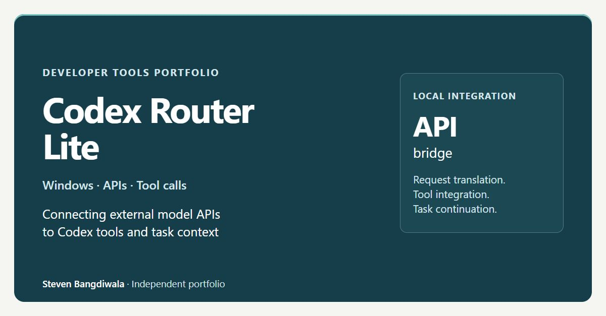
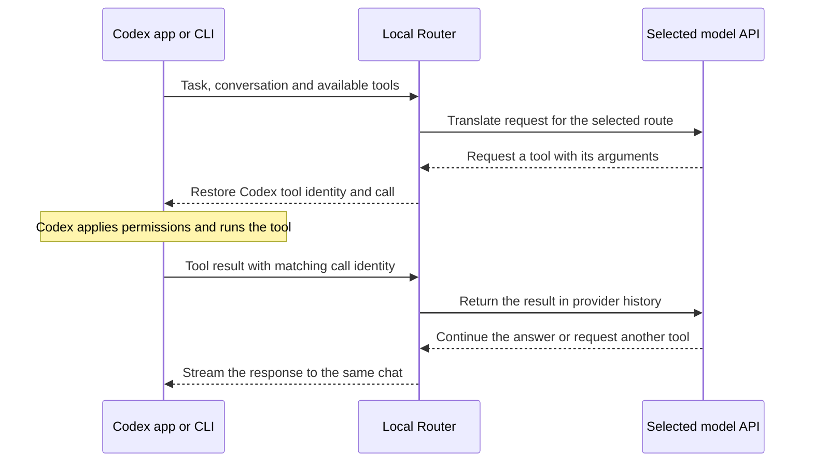

# Codex Router Lite

**Steven Bangdiwala** · Windows integration for external coding-agent models



[How it works](#how-it-works) · [Demonstration and evidence](docs/DEMONSTRATION.md) ·
[Models and routes](docs/MODELS.md) · [Setup](#setup) ·
[Troubleshooting](docs/TROUBLESHOOTING.md)

Codex Router Lite connects supported external model APIs to the Windows Codex
app and command-line client. The local service translates requests, streamed
responses, tool calls and conversation history. Codex runs the tools and
applies its sandbox permissions and approvals. Native GPT models remain
available through the user's Codex login.

This is an independent Windows adaptation of
[duolahypercho/codex-router](https://github.com/duolahypercho/codex-router),
currently before version 1.0. The Lite adaptation maintains Windows installation
and recovery, explicit provider routes, native-model catalog integration and
tested tool-return handling. [Third-party notices](NOTICE.md) credit the original
Router, OpenCodex and NVIDIA NeMo Switchyard separately.

## Engineering contribution

| Work | Why it matters | Inspect it |
| --- | --- | --- |
| Request and response translation | Preserves tool identity, arguments and history as requests cross provider APIs | [Request preparation](docs/agents/request-preparation.md) |
| Exact provider routes | Makes endpoint choice and compatibility rules explicit | [Model registry](src/routed-models.mjs) and [route guides](docs/MODELS.md) |
| Native collaboration checks | Exercises a real tool result and a follow-up on the same routed child | [Demonstration](docs/DEMONSTRATION.md) and [certification runner](maintenance/certification-runner.mjs) |
| Windows installation and recovery | Preserves user-owned settings, checks service ownership and retains recovery state | [Installer and updates](docs/INSTALL.md) |
| Switchyard integration | Connects automatic native-model selection to the Codex request path | [Integration and routing policy](config/switchyard/README.md) |

## How it works

This diagram describes the ordinary tool-return path:



The model asks to use a tool; Codex executes it. Provider translation must
preserve the returned result and conversation state so the model can continue.
Each model and endpoint has its own route. Integration work is needed when
an API differs in tools, history or streaming behavior.

### Demonstration and evidence

In the **October 11, 2026 CLI check**, all six tested routes requested an actual
sandboxed command, received output `42`, completed the requested first marker
and returned a second marker from the same child thread. Separate requests
verified streamed completion. The
[readable demonstration](docs/DEMONSTRATION.md) includes the exact command,
sequence, versions and observed outputs, with links to the unchanged machine
record.

This is synthetic compatibility evidence for the named CLI runtime and endpoints.
It does not establish desktop elevated-sandbox compatibility, arbitrary MCP-tool
compatibility or productivity gains. [Accepted applications](v2_agent/README.md)
retain each route's dated evidence and earlier certification history.

## Models and routes

Configured routes cover GLM through StreamLake and Together, DeepSeek through
Together and DeepInfra, Pareto through Unbiased, and Switchyard automatic native
routing. [Models and routes](docs/MODELS.md) lists exact IDs, reasoning and tool
behavior, subagent settings and model onboarding. Switchyard requires a separate
local build; native GPT access remains available without an OpenRouter key.

## Setup

Use Windows 10 or 11, PowerShell 5.1 or newer, Git, Node.js 22.19 or newer,
Python 3.10 or newer (or uv), and an installed Codex app or CLI.

```powershell
git clone https://github.com/stevennitesh/codex-router-lite.git
Set-Location codex-router-lite
.\install.ps1 -Target codex
.\model-router.ps1 codex provider-key openrouter set
.\model-router.ps1 codex doctor
```

Enter your OpenRouter key through the protected prompt. Fully quit and reopen
Codex to reload the model picker. Select a configured route and ask it to inspect
one small file and run an existing check. The app should show tool calls and
results under the chat's permissions.

[Installation and updates](docs/INSTALL.md) covers managed settings, updates,
recovery and runtime replacement. [Switchyard maintenance](config/switchyard/maintenance.md)
covers its separate build. For tool failures or lost history, use
[troubleshooting](docs/TROUBLESHOOTING.md) and the
[debugging guide](docs/agents/debugging.md).

## Data sent to providers

External model requests send the supplied conversation, workspace context and
tool results to the selected provider through OpenRouter. Codex credentials and
account headers are excluded. Switchyard sends limited current task text to
OpenRouter/Jev for model selection; ordinary tool results, assistant answers and
reasoning are excluded from that classifier input. See [security](SECURITY.md)
and the [routing policy](config/switchyard/README.md#routing-policy) for exact rules.
Keep keys and unredacted private logs out of public issues and commits.

## Development and attribution

Use the [issue forms](CONTRIBUTING.md) to report problems or propose changes;
external pull requests are not accepted. Contributors working in a fork can
start with [AGENTS.md](AGENTS.md) and the [architecture](docs/agents/architecture.md).
For local checks, run `npm ci`, then choose the scope in the
[verification guide](docs/agents/architecture.md#verification). Full source
verification is `npm run verify`; it does not send model requests.

[Third-party notices](NOTICE.md) distinguish inherited components and this
adaptation. This project is not affiliated with OpenAI or OpenRouter.
[MIT License](LICENSE).
